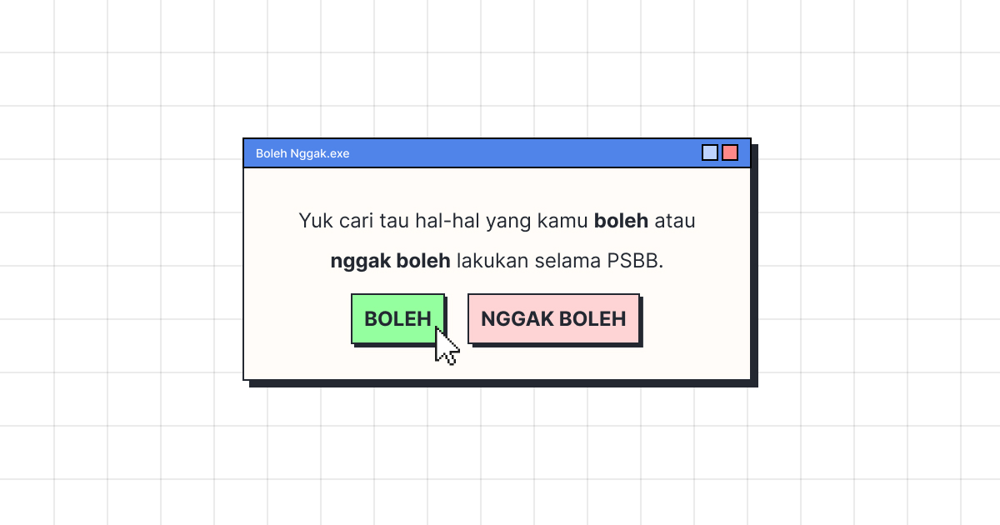

# BolehNggak.id

> [!NOTE]
> This repository is archived. The project ended in 2020, the `bolehnggak.id` domain has expired, and the code no longer builds. A static copy of the site still runs at [bolehnggak-id.netlify.app](https://bolehnggak-id.netlify.app).

  

BolehNggak.id ("allowed or not?") answered one question for people in Jakarta during the 2020 COVID-19 Large-Scale Social Restrictions (PSBB). Can I do this activity right now? You picked an activity, and the site told you whether the PSBB rules allowed it, allowed it with conditions, or banned it. Each answer linked to the regulation it came from.

The project is an Indonesian version of [canigo.sg](https://canigo.sg), built with permission from its developers.

## Why it existed

The PSBB rules lived in long legal documents and dense infographics. Most people looked them up only when they had a specific plan, and finding the one rule that applied took too long. Many people kept doing activities without knowing the rules banned them. BolehNggak.id answered the question for one activity at a time.

## How it worked

- A public [Google Sheet](https://docs.google.com/spreadsheets/d/16skDPETqaL8RXGsfhDtWsNLLtOabbE76Tfw_IzmR0Bg/edit?usp=sharing) held every answer. Visitors suggested activities in the sheet. The team reviewed each suggestion, wrote the answer, added a source, and marked the row as published.
- At build time, `gatsby-source-google-sheets` read the `CROWDSOURCE` worksheet. `gatsby-node.js` created one static page for each published row, at the row's slug.
- Each answer had one of three types: `can`, `can-but`, or `can-not`. The answer page shows them in green, amber, and red.
- If no regulation covered an activity directly, the answer showed a disclaimer. The disclaimer said that the answer came from the team's reading of Jakarta's PSBB regulation, Pergub DKI Jakarta No. 33/2020.
- Netlify hosted the static build.

The stack is Gatsby 2, React 16, Emotion with twin.macro and Tailwind CSS, and Google Sheets as the content source.

## Why it no longer builds

The dependencies date from 2020, and changes to the Google Sheets API broke the source plugin. A build also needs a Google service account credential, read from `GOOGLE_SERVICE_CREDENTIALS` in production and from `google-service-credential.json` in development. The code stays here as a record of the project. Nobody maintains it.

## Further reading

- [What I Learned from BolehNggak.id](https://www.linkedin.com/pulse/what-i-learned-from-bolehnggakid-interactive-center-social-gustika/), an article on lessons from the project.
- [XDS Lab's Instagram post](https://www.instagram.com/p/B_2IrTQlw8m/?img_index=1) featuring the project.

## Team

Arian, Wahyu, Lintang, Aswin, Rose, and Rara built and ran BolehNggak.id. Thank you to everyone in Indonesia who used the site and suggested activities.

## License

MIT. See [LICENSE.md](LICENSE.md).

## Contact

The repository is archived, so you can't open issues. For questions about the project, email [arian.raptor@gmail.com](mailto:arian.raptor@gmail.com).
