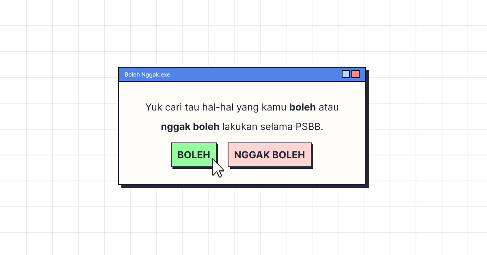

# BolehNggak.id

An archived website that told people in Indonesia which activities the 2020 COVID-19 PSBB rules allowed.

**Status:** Archived. The `bolehnggak.id` domain has expired, and a static copy of the site still runs at [bolehnggak-id.netlify.app](https://bolehnggak-id.netlify.app). Public repository with one owner.

BolehNggak.id means "allowed or not?" in casual Indonesian. During the 2020 Large-Scale Social Restrictions (Pembatasan Sosial Berskala Besar, or PSBB), the site answered one question: can I do this activity right now? You picked an everyday activity, such as going to the mall or a nearby park. The site told you whether the PSBB rules allowed it, allowed it with conditions, or banned it. It also linked the regulation behind the answer.

## Why it existed

The PSBB rules lived in long legal documents and dense infographics. The central government, the provinces, and the ministries each published their own instructions, and these did not always agree. None of them covered every everyday activity.

Most people looked the rules up only when they had a specific plan, and finding the one rule that applied took too long. Many people kept doing activities without knowing that the rules banned them. BolehNggak.id answered the question for one activity at a time, in casual Indonesian.

## History

A group of friends started the site in March 2020. For its first three months, it had about 4,000 visitors a day. The team stopped maintaining it in the fourth month.

The project is an Indonesian version of canigo.sg, a Singapore site that is now offline. The team built it with permission from the canigo.sg developers.

## How it worked

- A public [Google Sheet of activities and answers](https://docs.google.com/spreadsheets/d/16skDPETqaL8RXGsfhDtWsNLLtOabbE76Tfw_IzmR0Bg/edit?usp=sharing) held every answer. Visitors suggested activities in the sheet. The team reviewed each suggestion, wrote the answer, added a source, and marked the row as published.
- At build time, `gatsby-source-google-sheets` read the `CROWDSOURCE` worksheet. `gatsby-node.js` made one static page for each published row, at the row's slug.
- Each answer had one of three types: `can`, `can-but`, or `can-not`. The answer page shows them in green, amber, and red.
- Some activities had no regulation that covered them directly. Their answers showed a disclaimer instead of a source. The disclaimer said that the answer came from the team's reading of the PSBB government regulation, and asked readers to use it wisely.
- Buttons let you share the answer on Facebook, Twitter, and WhatsApp.
- Netlify hosted the static build.

The stack is Gatsby 2, React 16, Emotion with twin.macro and Tailwind CSS, and Google Sheets as the content source.

## Why the code no longer builds

The code stays here as a record of the project. It no longer builds, for two reasons:

- `gatsby-config.js` needs a Google service account key. In production it reads the key from the `GOOGLE_SERVICE_CREDENTIALS` environment variable. In development it reads `google-service-credential.json`, which is not in the repository. Without the key, the build stops at once.
- `gatsby-source-google-sheets` uses `google-spreadsheet` 2.0.3. That library calls Google's old Sheets feed API at `spreadsheets.google.com/feeds`, which Google has since turned off.

The dependencies also date from 2020. The scripts in `package.json` show how the team worked: `gatsby develop` to run the site locally, and `gatsby build` to make the static site.

## What the team learned

These points come from Lintang Gustika's article, linked under [Further reading](#further-reading):

- regulations changed often, and central and regional rules were not always in sync. The team rewrote answers many times to keep the sources current.
- the rules had no fixed penalties, which gave people less reason to look them up.
- about 60% to 70% of working people in Indonesia are informal workers. Many had to go out every day to earn a living, whatever the rules said.
- the team had no clear way to keep answers current, and out-of-date answers would add to the confusion. So the team stopped maintaining the site.

## Further reading

- [What I Learned from BolehNggakId](https://www.linkedin.com/pulse/what-i-learned-from-bolehnggakid-interactive-center-social-gustika/) by Lintang Gustika, January 2021. It covers what worked, what did not, and why the team stopped.
- [XDS Lab's Instagram post about BolehNggak.id](https://www.instagram.com/p/B_2IrTQlw8m/?img_index=1).

## Team

Wahyu Dwi Widharto, Arian Pradana, Aswin Prasetyo, Rose Kusuma Diah Tantri, Lintang Gustika, and Rara built and ran BolehNggak.id. Thank you to everyone in Indonesia who used the site and suggested activities.

## Project structure

| Path                              | What it holds                                                          |
| --------------------------------- | ---------------------------------------------------------------------- |
| `gatsby-config.js`                | The site's settings and plugins, including the Google Sheet ID         |
| `gatsby-node.js`                  | The query that turns each published row into a page                    |
| `src/templates/answer.js`         | The page for one activity                                              |
| `src/containers/Answer/Answer.js` | The answer, its color, its source or disclaimer, and the share buttons |
| `src/translations/constants.js`   | All the Indonesian text on the site                                    |

## Contributing

Report bugs and ask questions in [GitHub issues](https://github.com/arianjinx/bolehnggak_id/issues). Nobody maintains this repository, so issues and pull requests may not get a reply.

Coding agents work in it by the rules in [AGENTS.md](AGENTS.md).

For questions about the project, email [arian.raptor@gmail.com](mailto:arian.raptor@gmail.com).

## License

[MIT](LICENSE.md), copyright 2020 BolehNggak.id.

- [`LICENSE`](LICENSE): MIT, from the `gatsby-starter-default` template the site began as, copyright 2015 gatsbyjs.
